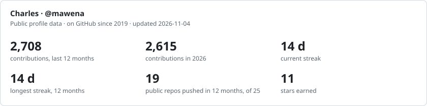
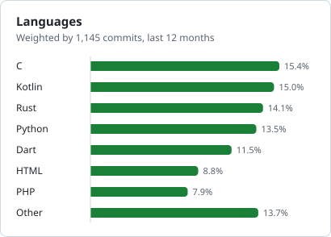
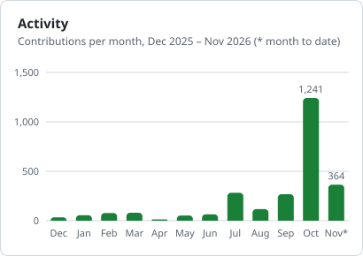

<h1 align="center">Hi 👋, I'm Charles GAMLIGO aka <b>mawena</b></h1>

<h3 align="center">Fullstack & systems developer · Lomé, Togo 🇹🇬</h3>

  <b>Laravel & Vue.js</b> for business platforms · <b>Rust, C & Flutter</b> for tools that run close to the system · <b>Linux packaging</b> and <b>local AI</b>

  I build web platforms for businesses (REST APIs, back-offices, credit and reporting workflows), and on the side, the tools I wish existed: an Android file manager that opens encrypted drives, a native git client, a portable filesystem, an offline voice assistant. Self-taught, design-minded, and I ship: versioned releases, <code>.deb</code> packages and my own APT repository.

  
  
  

---

### 🛠️ What I'm building in 2026

**Systems & desktop**

| Project | What it does | Stack |
|---|---|---|
| [**Portail**](https://github.com/mawena/Portail) | Android file manager that opens LUKS-encrypted USB drives **without root**: ext4, NTFS, exFAT, SFTP, encrypted vaults. My biggest project, 500+ commits this year. APK on each release. | Flutter · Kotlin · C (lwext4, mbedTLS) |
| [**dada**](https://github.com/mawena/dada) | Portable filesystem for USB drives, read/write on Linux, macOS and Windows, with its own spec, a journal, CRC32C checksums and fuzzing. | Rust · FUSE · WinFsp |
| [**GiGit**](https://github.com/mawena/GiGit) | Fast native desktop git client, inspired by ungit. `.deb` on each release. | Rust · egui |

**Local AI**

| Project | What it does | Stack |
|---|---|---|
| [**Jarvis**](https://github.com/mawena/Jarvis) | Offline French voice assistant for the desktop: wake word, speaker check, control of media, apps and the web. | Rust · whisper · sherpa-onnx · Piper |
| [**Atelier**](https://github.com/mawena/Atelier) | One binary that installs self-hosted open LLMs behind an OpenAI-compatible, key-secured API. Static builds for x86_64 and aarch64. | Rust · Docker · Ollama / vLLM |
| [**Voix-là**](https://github.com/mawena/Voix-la) | Re-voices a song or a talk with a cloned voice. The heavy lifting runs on free Kaggle GPUs. | Python · Seed-VC · Whisper |

**Web & Laravel**

| Project | What it does | Stack |
|---|---|---|
| [**Maravel**](https://github.com/mawena/maravel)   | Laravel library for REST APIs: generic CRUD controller, database-driven roles & permissions, auto-wired policies, advanced filters, Artisan generators. The base of my Laravel apps. | PHP 8.1–8.4 · Laravel 10–13 |
| [**Pulse**](https://github.com/mawena/pulse) | Live monitoring cockpit for Ubuntu VPS: metrics over WebSocket, processes, services, audit. [Live demo →](https://pulse.mawena.cloud) | Laravel 13 · Vue 3 · Reverb |

**Linux tooling** · installable with `apt` from my own repository, [mawena.cloud/repo](https://mawena.cloud/repo)

| Project | What it does | Stack |
|---|---|---|
| [**lnmp**](https://github.com/mawena/lnmp) | Installs and runs an Nginx + MariaDB + PHP + Certbot stack on Ubuntu, from the command line or a web panel. | Bash · Python |
| [**dnsmasq-webui**](https://github.com/mawena/dnsmasq-webui) | Turns a box into a LAN DNS/DHCP server with a web admin panel. | PHP · dnsmasq |
| [**dbbackup**](https://github.com/mawena/dbackup) | MySQL/MariaDB backups to a remote VPS over rsync and SSH, with rotation and a systemd timer. | Bash · systemd |

**Just for fun:** [**MawCraft**](https://github.com/mawena/MawCraft), a voxel sandbox in the browser with an infinite seeded world, touch controls and multiplayer (Three.js + WebSocket).

### 📊 By the numbers

<picture>
  <source media="(prefers-color-scheme: dark)" srcset="https://raw.githubusercontent.com/mawena/mawena/output/overview-dark.svg" />
  
</picture>

  <picture>
    <source media="(prefers-color-scheme: dark)" srcset="https://raw.githubusercontent.com/mawena/mawena/output/languages-dark.svg" />
    
  </picture>
  <picture>
    <source media="(prefers-color-scheme: dark)" srcset="https://raw.githubusercontent.com/mawena/mawena/output/activity-dark.svg" />
    
  </picture>

Refreshed every day by this repository's own GitHub Action (<a href="https://github.com/mawena/mawena/blob/HEAD/scripts/profile_cards.py"><code>scripts/profile_cards.py</code></a>), from public profile data.

### 🧰 Stack

<b>Web</b>&nbsp;

<b>Systems & mobile</b>&nbsp;
<picture>
  <source media="(prefers-color-scheme: dark)" srcset="https://cdn.simpleicons.org/rust/ffffff" />
  
</picture>

<b>Data & ops</b>&nbsp;

### 💼 Work with me

- **Open to freelance work and collaborations:** SaaS, business platforms, REST APIs, back-offices, process automation, Linux servers. See [mawena.cloud](https://mawena.cloud).
- 📫 **gamligocharles@gmail.com**, replies within 24h, in French or English.

### 🌐 Connect

---

<i>💡 Have a project in mind? Let's talk → <a href="https://mawena.cloud">mawena.cloud</a></i>

