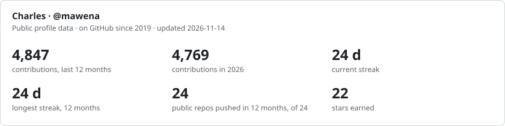
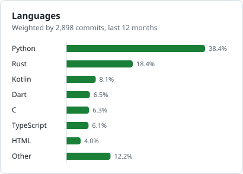
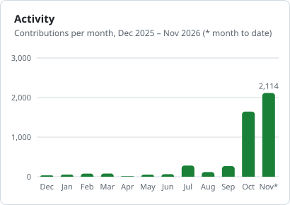

<h1 align="center">Hi 👋, I'm Charles GAMLIGO aka <b>mawena</b></h1>

<h3 align="center">Fullstack & Linux developer · Lomé, Togo 🇹🇬 · open to remote roles and freelance</h3>

  <b>Laravel & Vue.js</b> for business platforms · <b>Python, Rust & Flutter</b> for desktop, mobile and system tools · <b>Debian packaging</b> · <b>local AI</b>

  I take products from an idea to something people install and update: roadmap, code, tests, docs, versioned releases, <code>.deb</code> packages and signed APT repositories. I work every day with AI coding agents, and I build the tools that make that way of working scale.

  
  
  
  

---

### ⚡ 2026 in numbers

- **77 releases** published in 2026 across 9 public projects, each with its changelog and its GitHub release.
- **5 signed APT repositories**: [CCS](https://mawena.github.io/CCS/), [Gagarine](https://mawena.github.io/gagarine/), [Voix-là](https://mawena.github.io/Voix-la/) and [Sésame](https://mawena.github.io/sesame/) on GitHub Pages, plus [lnmp and dnsmasq-webui](https://mawena.cloud/repo/) on my own server. Users get new versions with `apt upgrade`.
- **1 Laravel library on Packagist**, [Maravel](https://packagist.org/packages/mawena/maravel), the base of my Laravel apps.
- **4,800+ contributions** over the last 12 months (live cards below).

### ⭐ Featured projects

<table>
<tr>
<td width="50%" valign="top">

**[CCS](https://github.com/mawena/CCS)** 

Several Claude Code accounts on one Linux PC, working as one: one-command switch, usage forecasts, automatic switch before the cap, an orchestrator for the 5-hour windows, and a GNOME app laid out like VS Code (graphical chat, project files, roadmap, terminal).

Python · GTK 4 / libadwaita · signed APT repo · [site](https://mawena.github.io/CCS/)

</td>
<td width="50%" valign="top">

**[Gagarine](https://github.com/mawena/gagarine)** 

RAM guard for Linux: it freezes the runaway process before the desktop locks up, runs heavy jobs through a queue under kernel memory limits, learns how much RAM each job really takes, flags leaks, and ships a compressed swap, a GNOME app and a top-bar indicator.

Python · systemd · cgroups · zram · GTK 4 · [site](https://mawena.github.io/gagarine/)

</td>
</tr>
<tr>
<td width="50%" valign="top">

**[Portail](https://github.com/mawena/Portail)** 

Android file manager that opens LUKS2-encrypted USB drives **without root**, with read and write on ext4, FAT, exFAT and NTFS. Native C11 engine behind JNI, tabs, SFTP/SSH, encrypted vaults, storage analyzer. Writes are checked by `e2fsck` and the Linux kernel, under ASan/UBSan. My biggest project: 600+ commits.

Flutter · Kotlin · C11 (lwext4, ntfs-3g) · APK on each release

</td>
<td width="50%" valign="top">

**[Voix-là](https://github.com/mawena/Voix-la)** 

Dubs a video or a song with a cloned voice (yours, or that of someone who agrees): vocals separated, cleaned and converted on a free cloud GPU (Kaggle, or Modal / Runpod), song moved to your vocal range, one voice per singer, translated lyrics, karaoke.

Python · Seed-VC · Whisper · GNOME app · [site](https://mawena.github.io/Voix-la/)

</td>
</tr>
<tr>
<td width="50%" valign="top">

**[Canapé](https://github.com/mawena/Canape)** 

Watch a movie together, each at home, seeing and hearing each other. No screen sharing: every browser streams the film from the server, playback stays in sync, and cameras and mics go peer to peer. Resumable uploads, playback of any format. Self-hosted and in production.

TypeScript · Node.js · WebRTC · nginx

</td>
<td width="50%" valign="top">

**[Maravel](https://github.com/mawena/maravel)** 

Laravel library for REST APIs: generic CRUD controller, filters, sorting and pagination, database-driven roles and permissions (CASL-compatible), automatic policies, Artisan generators. Powers [Pulse](https://github.com/mawena/pulse), [maravel-xy](https://github.com/mawena/maravel-xy) and [loan](https://github.com/mawena/loan).

PHP 8.1+ · Laravel 10 to 13

</td>
</tr>
</table>

### 🧰 More projects

**Linux & desktop**

| Project | What it does | Stack |
|---|---|---|
| [**Sésame**](https://github.com/mawena/sesame) | Joins an Ubuntu desktop to Microsoft Entra ID the way a Windows PC does: work email and machine name, then password, phone approval and PIN at the login screen. The local account is kept as is. | Python · Himmelblau · signed APT repo |
| [**GiGit**](https://github.com/mawena/GiGit) | Fast native git client: commit graph, staging by file, hunk or line, safe force-push, French and English UI. `.deb` on each release. | Rust · egui |
| [**lnmp**](https://github.com/mawena/lnmp) | Installs and runs an Nginx + MariaDB + PHP + Certbot stack on Ubuntu, from the command line, a menu or a web panel. Local HTTPS domains with mkcert. [Site →](https://lnmp.mawena.cloud) | Bash · Python · APT |
| [**dnsmasq-webui**](https://github.com/mawena/dnsmasq-webui) | Turns an Ubuntu box into a LAN DNS/DHCP server with a web panel and Pi-hole-style domain blocking. The web server never runs as root: one narrow wrapper validates and applies the config. | PHP · dnsmasq · APT |
| [**dada**](https://github.com/mawena/dada) | Portable filesystem for USB drives, read/write on Linux, macOS and Windows: its own on-disk spec, metadata journal, CRC32C, fsck and fuzzing. | Rust · FUSE · WinFsp |

**Local & self-hosted AI**

| Project | What it does | Stack |
|---|---|---|
| [**Jarvis**](https://github.com/mawena/Jarvis) | Local-first French voice assistant for Linux: Whisper speech recognition, speaker verification, Piper voice, local LLM (Qwen 3.5 through LM Studio) or Claude. Controls media, apps and the web, with Android "ears" on the LAN. | Rust (8 crates) · UniFFI |
| [**Atelier**](https://github.com/mawena/Atelier) | One static binary that deploys open LLMs on your servers behind a key-secured, OpenAI-compatible API: Ollama or vLLM, LiteLLM, PostgreSQL, Caddy. | Rust · Docker |
| [**Jideo**](https://github.com/mawena/Jideo) | Face swap for photos and videos, 100% local on CPU, with a web UI, visible watermark and "AI-generated" metadata. | FastAPI · InsightFace · Vue 3 |

**Web & business**

| Project | What it does | Stack |
|---|---|---|
| [**Pulse**](https://github.com/mawena/pulse) | Live monitoring cockpit for Ubuntu VPS: metrics over WebSocket, processes, systemd services, roles, audit log. [Live demo →](https://pulse.mawena.cloud) | Laravel 13 · Vue 3 · Reverb |
| [**maravel-xy**](https://github.com/mawena/maravel-xy) | Laravel + Vue starter kit: Sanctum auth, roles and permissions shared by the API and the UI through CASL, generated tables and forms, French, English and Arabic. | Laravel 12 · Vuetify 3 |
| [**loan**](https://github.com/mawena/loan) | Credit simulator in CFA francs: three amortization methods, offer comparison, early repayment, PDF, Word and Excel exports. | Laravel 12 · Vue 3 |
| [**fcx-toolkit**](https://github.com/mawena/fcx-toolkit) | Command-line tool for the Oracle FLEXCUBE core banking system: SQL and PL/SQL runs, CSV and Excel exports, accounting batches through the FCUBS API, one JSON output. | Python · Oracle |
| [**immich**](https://github.com/mawena/immich) | One-command manager for a self-hosted Immich photo server: safe updates with a database backup, restore, external libraries. | Bash · Docker Compose |

**Just for fun:** [**MawCraft**](https://github.com/mawena/MawCraft), a voxel sandbox in the browser with an infinite seeded world, touch controls and multiplayer (Three.js + WebSocket).

**Coming next:** [**Diapason**](https://github.com/mawena/Diapason), an Ubuntu app that recognizes the audio output (headphones, Bluetooth speaker, HDMI…) and applies the settings that make it sound best.

### 🤝 What I bring to a team

- **End-to-end delivery:** spec, roadmap, code, tests, docs and releases, with git flow, semantic versioning, changelogs and CI.
- **Web platforms:** Laravel and Vue 3 back-offices, REST APIs, roles and permissions, real time (Reverb, WebSocket, WebRTC).
- **Linux & DevOps:** Debian packaging, signed APT repositories, systemd services, cgroups, nginx, Docker, Let's Encrypt.
- **Systems & mobile:** Rust, C11 behind JNI, Flutter and Kotlin on Android.
- **AI integration:** local LLMs (LM Studio, Ollama, vLLM), Whisper, voice conversion on cloud GPUs, and daily work with AI coding agents.
- **Business domains:** banking tools (Oracle FLEXCUBE, credit simulation), back-offices and reporting.

### 📊 By the numbers

<picture>
  <source media="(prefers-color-scheme: dark)" srcset="https://raw.githubusercontent.com/mawena/mawena/output/overview-dark.svg" />
  
</picture>

  <picture>
    <source media="(prefers-color-scheme: dark)" srcset="https://raw.githubusercontent.com/mawena/mawena/output/languages-dark.svg" />
    
  </picture>
  <picture>
    <source media="(prefers-color-scheme: dark)" srcset="https://raw.githubusercontent.com/mawena/mawena/output/activity-dark.svg" />
    
  </picture>

Generated by this repository's own script (<a href="https://github.com/mawena/mawena/blob/HEAD/scripts/profile_cards.py"><code>scripts/profile_cards.py</code></a>), from public profile data.

### 🛠️ Stack

<b>Web</b>&nbsp;

<picture>
  <source media="(prefers-color-scheme: dark)" srcset="https://cdn.simpleicons.org/threedotjs/ffffff" />
  
</picture>

<b>Systems & mobile</b>&nbsp;

<picture>
  <source media="(prefers-color-scheme: dark)" srcset="https://cdn.simpleicons.org/rust/ffffff" />
  
</picture>

<b>Data & ops</b>&nbsp;
<picture>
  <source media="(prefers-color-scheme: dark)" srcset="https://cdn.simpleicons.org/mariadb/c0765a" />
  
</picture>
<picture>
  <source media="(prefers-color-scheme: dark)" srcset="https://cdn.simpleicons.org/mysql" />
  
</picture>

<picture>
  <source media="(prefers-color-scheme: dark)" srcset="https://cdn.simpleicons.org/gnubash" />
  
</picture>

### 💼 Work with me

- **Hiring?** I'm open to remote roles: fullstack (Laravel / Vue), backend, Linux and tooling. Based in Lomé (UTC+0), so my working day overlaps fully with Europe's. I work in French and English.
- **Freelance:** business platforms, REST APIs, back-offices, process automation, Linux servers and packaging. See [mawena.cloud](https://mawena.cloud).
- **Open source:** issues and pull requests are welcome. [CCS](https://github.com/mawena/CCS/blob/HEAD/ROADMAP.md), [Gagarine](https://github.com/mawena/gagarine/blob/HEAD/ROADMAP.md), [Sésame](https://github.com/mawena/sesame/blob/HEAD/ROADMAP.md), [Canapé](https://github.com/mawena/Canape/blob/HEAD/ROADMAP.md) and [Jarvis](https://github.com/mawena/Jarvis/blob/HEAD/ROADMAP.md) keep a public roadmap: pick an open task and let's build it together.
- 📫 **gamligocharles@gmail.com**, replies within 24h.

### 🌐 Connect

---

<i>💡 Have a project or a role in mind? Let's talk → <a href="mailto:gamligocharles@gmail.com">gamligocharles@gmail.com</a> · <a href="https://mawena.cloud">mawena.cloud</a></i>

